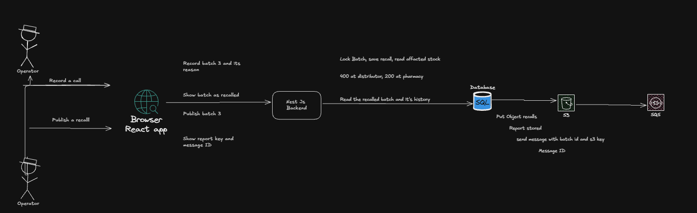

# MedTrace

A local demo for tracing pharmaceutical batches and identifying stock affected by a recall.

## Run locally

Start Docker Desktop in Linux container mode and run these commands from the repository root:

```powershell
docker compose up --build --wait
```

On a fresh database, apply the migrations in order. If you already applied some of them, run the loop with only the pending files.

```powershell
foreach ($migration in Get-ChildItem .\db\migrations\*.sql | Sort-Object Name) {
    Get-Content -Raw $migration.FullName |
        docker compose exec -T db psql -X -U medtrace -d medtrace -v ON_ERROR_STOP=1 --single-transaction -f -
    if ($LASTEXITCODE -ne 0) { throw "Migration failed: $($migration.Name)" }
}
```

Create a new active demo batch whenever you want to run the scenario again:

```powershell
Get-Content -Raw .\db\seed-demo.sql |
    docker compose exec -T db psql -X -qAt -U medtrace -d medtrace -v ON_ERROR_STOP=1 --single-transaction -f -
```

Open the printed URL. The batch has 400 units at the distributor and 200 at the pharmacy. Enter a reason, select **Record recall**, then select **Publish recall**. The screen shows the S3 object, the SQS message ID, and a link to download the report from S3. In the AWS Emulator panel, use **Read SQS messages** or **View S3 report** to inspect the payloads in the browser.

## Architecture



The diagram uses a demo batch with 400 units at the distributor and 200 at the pharmacy. It shows the order of operations. NestJS reads PostgreSQL, uploads the report to S3 through AWS Emulator, then sends the message to SQS through the emulator.

React sends requests to NestJS through Vite. PostgreSQL stores stock balances, movement history, and recalls. Recording a recall blocks later receipts and transfers for that batch. Publishing is a separate, retryable action that uses the AWS SDK against the local AWS Emulator container.

The JSON report goes to the emulated S3 bucket `medtrace-recall-reports`. An SQS FIFO message references the report in `medtrace-recall-notifications.fifo`. Republishing writes to the same object key, and SQS uses the batch ID for its FIFO deduplication window. The queue represents notifications waiting to be processed.

AWS Emulator runs with telemetry off. Compose shares its generated connection files with the API and verifies HTTPS using the emulator certificate. The ports are published on localhost, and the API uses emulator credentials and the local Compose endpoint.

Run `docker compose down` to stop the stack and retain the PostgreSQL volume. The emulator stores objects and messages in memory, so republish a saved recall after restarting it. The first build downloads packages and images. To refresh the emulator package, run `docker compose build --pull --no-cache aws-emulator` before restarting the stack.
